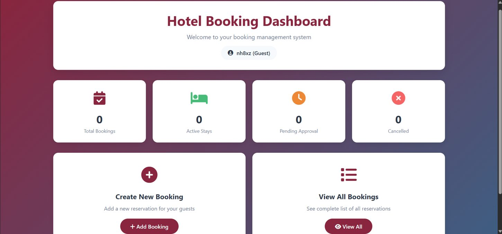
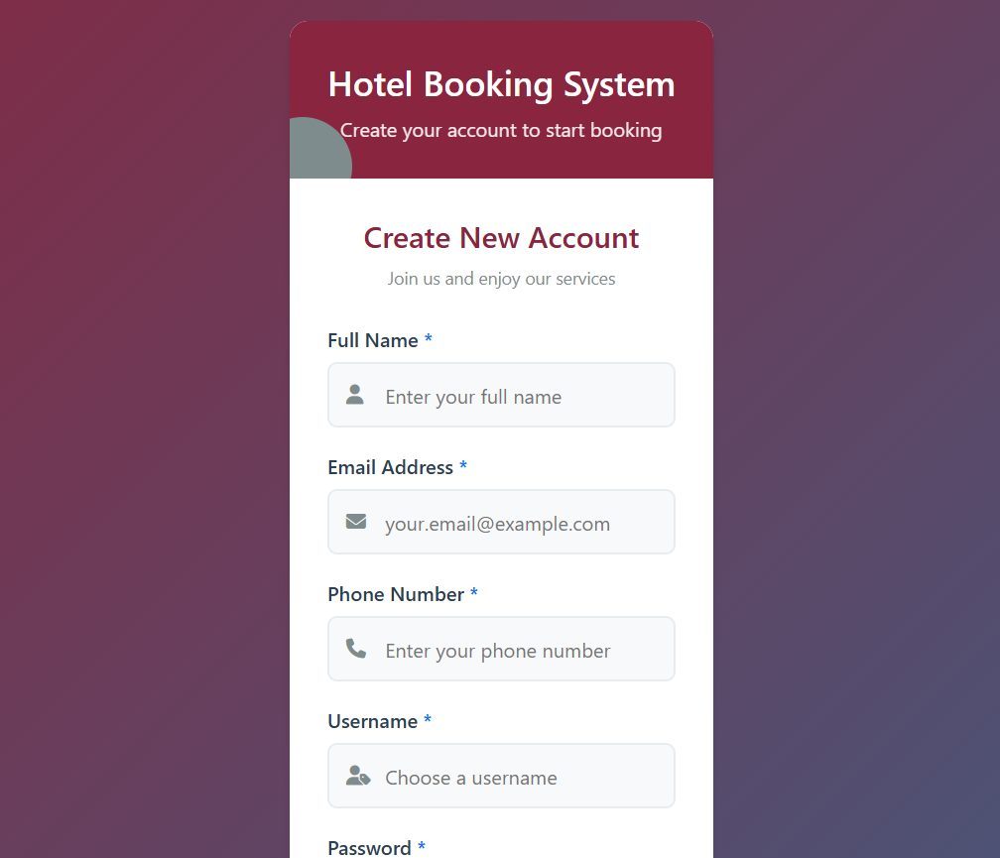
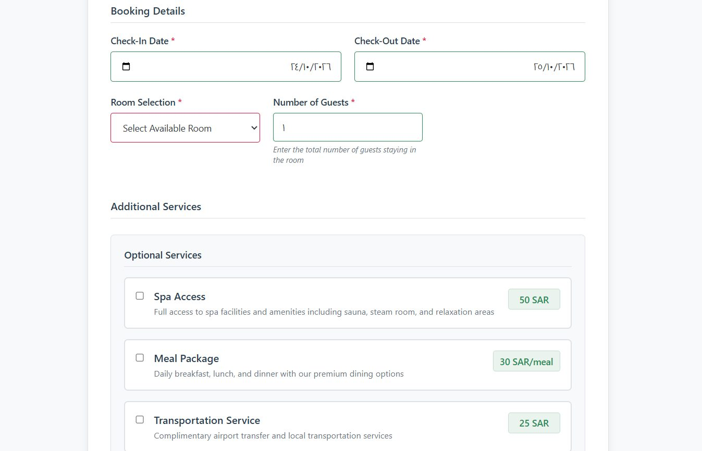
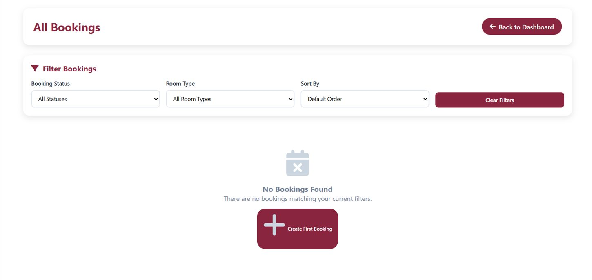

<div align="center">

# 🏨 Hotel Room Booking System

### From guest registration to reservation management — all in one web application.

A C# and ASP.NET Web Forms project that brings together room booking, guest management, booking status tracking, and an at-a-glance dashboard.

  

**[Explore the dashboard](#-a-look-inside) · [Discover the features](#-what-the-system-does) · [Run the project](#-getting-started)**

</div>

---

## ✨ A look inside

> A real screenshot of the booking dashboard, captured while running the application locally.



The dashboard brings key reservation statuses together: **Total Bookings**, **Active Stays**, **Pending Approval**, and **Cancelled**.

### More screens

| Create an account | Create a booking |
|:---:|:---:|
|  |  |
| Guest registration | Dates, room selection and optional services |

**Browse and filter reservations**



*All images above are screenshots of the actual running application, not mockups.*

## 🚀 What the system does

- **Account access:** Register and sign in with guest accounts.
- **Booking workflow:** Select a room, enter guest details and choose check-in/check-out dates.
- **Availability checks:** Check room availability against existing bookings.
- **Price calculation:** Calculate room prices based on length of stay, seasonal adjustments and optional services.
- **Extra services:** Add spa access, meal packages or transportation to a reservation.
- **Reservation tracking:** View bookings, apply filters and track booking status.
- **Management views:** Access room management, statistics and role-specific navigation.
- **Additional pages:** Payment and notification interfaces are included in the project.

## 🧭 Typical guest journey

`Register / Log in` → `Open Dashboard` → `Choose Room & Dates` → `Add Services` → `Create Booking` → `Payment Page`

## 🛠️ Built with

| Layer | Technology |
| --- | --- |
| Application | C# |
| Web UI | ASP.NET Web Forms, HTML, CSS |
| Runtime | .NET Framework 4.8 |
| Data persistence | JSON files |
| Development | Visual Studio, IIS Express |

## 📁 Project layout

```text
Hotel-Room-Booking-System/
├── screenshots/                 # Actual application screenshots
├── WebApplicationRooms.sln      # Visual Studio solution
└── WebApplicationRooms/
    ├── Models/                  # Users, rooms, bookings and data logic
    ├── App_Data/                # Local data directory
    ├── LoginPage.aspx
    ├── RegisterPage.aspx
    ├── BookingsDashboard.aspx
    ├── AddBooking.aspx
    ├── BookingsList.aspx
    ├── Rooms.aspx
    ├── PaymentPage.aspx
    └── ...                      # Additional pages and code-behind files
```

## ▶️ Getting started

1. Clone or download the repository.
2. Open `WebApplicationRooms.sln` in **Visual Studio on Windows**.
3. Install the **.NET Framework 4.8 targeting pack** and ASP.NET web development workload if needed.
4. Restore NuGet packages when prompted.
5. Set `LoginPage.aspx` as the start page and run using IIS Express.
6. Create a local test account and configure sample room data if needed.

**Important:** Personal user and reservation data were intentionally excluded from the published repository. The application may need local sample data to demonstrate booking features. This is a student project; do not use it for real customer data or production payments without additional security and deployment work.

## 👩‍💻 Developer

**Nihal Hameed Alharbi**  
Computer Science  
[GitHub Profile](https://github.com/nihalAlharbi)

---

<div align="center">

*Designed to make hotel reservation workflows easier to explore, manage and understand.*

</div>
